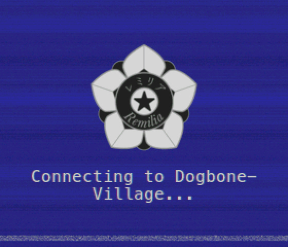
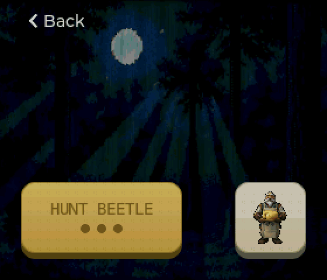
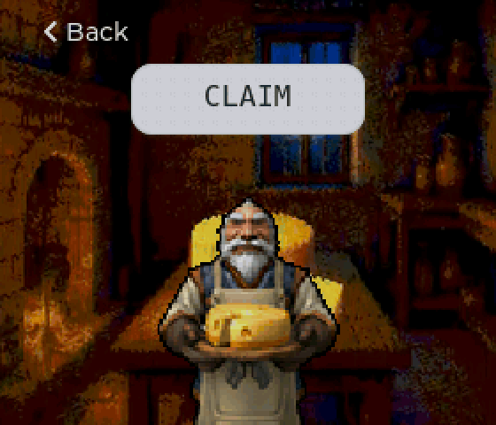
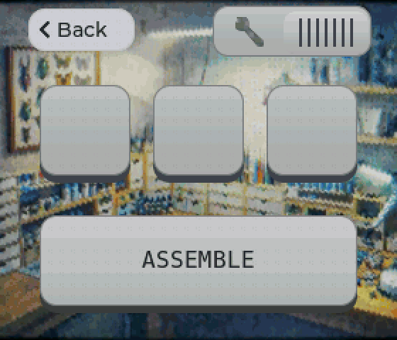
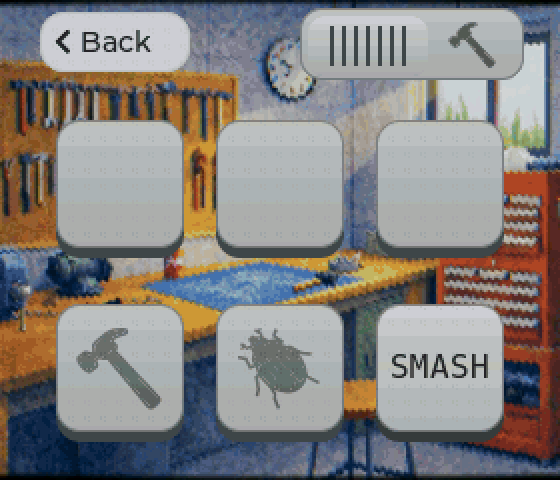
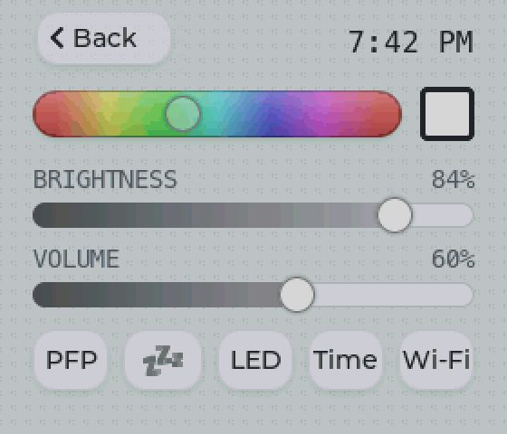

# BeetleBoy32

> [!WARNING]
> **Experimental prototype.** A hobby build, provided as is, with no warranty: use it at your own risk.
> - **Battery:** a lithium (LiPo) cell in a 3D-printed case. Use a protected cell, don't charge it unattended, and stop using it if it swells, heats up or gets damaged.
> - **Not waterproof**, not drop-tested, not certified.
> - **Your account:** it stores your remilia.net login (session cookies) unencrypted on the board. Anyone with the device and a USB cable could read them. Use "sign out everywhere" on remilia.net if it's lost.


A vibecoded pocket device for the [remilia.net](https://www.remilia.net) beetle game, built on the **Waveshare ESP32-S3-Touch-LCD-1.69** (a 1.69" touchscreen ESP32-S3 board). It signs into your remilia.net account over Wi-Fi and lets you play from it:

https://github.com/user-attachments/assets/1d96041b-7219-4d2f-a921-2b450ca8f8fa

- **Home:** profile card, notification when something is ready to claim
- **Hunt** beetles, **Claim** cheese
- **Craft:** assemble and smash
- **Pokes:** notification when someone pokes you
- **Settings:** pick your profile picture, theme color, and other settings!

The whole app also runs in a simulator window on a Mac, so you can work on it without the board.

See it in action in the [demo](#demo) below.

## Quick start

You need [PlatformIO](https://platformio.org/install/cli). For the simulator, also `brew install sdl2`.

```sh
./run sim      # the simulator
./run flash    # build and flash the board over USB-C
./run          # every command
```

On first boot, BeetleBoy32 walks you through connecting to Wi-Fi and signing in, with your phone or on its own keyboard. See [setup and login](docs/setup-and-login.md).

## Docs

- [Hardware](docs/hardware.md): the board, pins, optional buttons and LEDs, power behaviour
- [Simulator](docs/simulator.md): running it, keys, saved data, environment variables
- [Setup and login](docs/setup-and-login.md): first setup, what's stored on the device, factory reset
- [Code](docs/code.md): how the code is organized, and how to add screens, images and fonts
- [Roadmap](ROADMAP.md): what's planned

## Forking

`project.env` holds the repo URL and version shown on the About screen. Point `REPO_URL` at your fork.

## License

[Viral Public License](LICENSE). The Remilia artwork in `assets/` is used under the same license.

## Demo

<table>
  <tr>
    <td></td>
    <td></td>
  </tr>
  <tr>
    <td><b>Boot:</b> joins Wi-Fi, signs in, done</td>
    <td><b>Hunt</b></td>
  </tr>
  <tr>
    <td></td>
    <td></td>
  </tr>
  <tr>
    <td><b>Claim UBC and Junk faucet</b></td>
    <td><b>Assemble</b></td>
  </tr>
  <tr>
    <td></td>
    <td></td>
  </tr>
  <tr>
    <td><b>Smash</b></td>
    <td><b>Customizable! Yay!</b></td>
  </tr>
</table>
