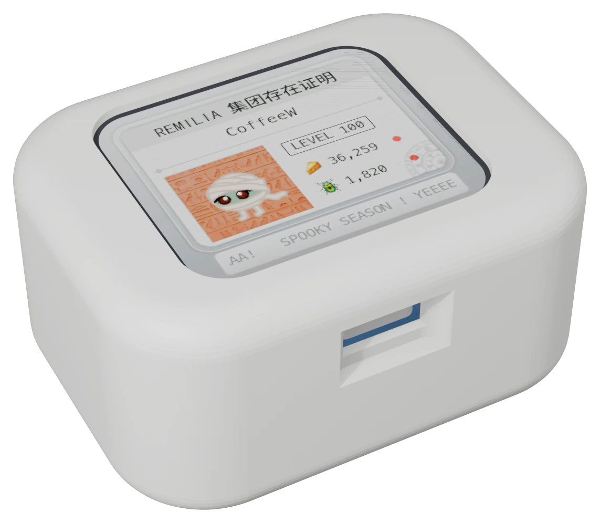
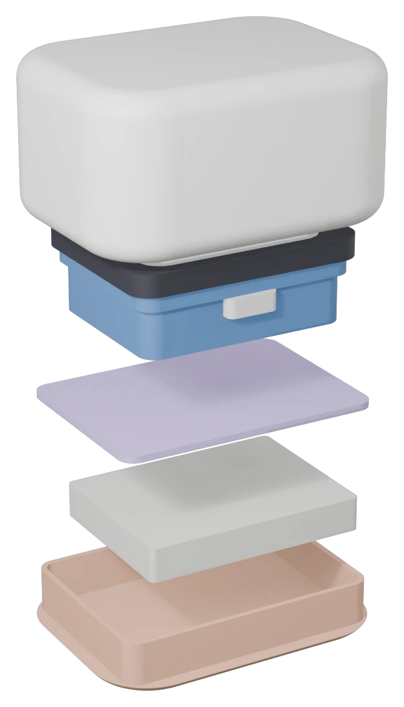

# Hardware

BeetleBoy32 runs on the **Waveshare ESP32-S3-Touch-LCD-1.69**: an ESP32-S3 with 16 MB flash, 8 MB PSRAM, a 1.69" 240×280 touchscreen (ST7789V2 + CST816T), a buzzer, an RTC and a battery connector. The app uses the screen in landscape (280×240).

All pin numbers are in [`include/board_config.h`](../include/board_config.h).



## Materials

| Part | What |
|---|---|
| Board | Waveshare ESP32-S3-Touch-LCD-1.69 |
| Battery | 603040 LiPo: 3.7 V, 800 mAh, with a protection circuit, MX1.25 plug |
| Case | Shell, divider and cover, 3D-printed |
| Optional | 4 WS2812B LEDs (see [Optional extras](#optional-extras)) |



To assemble:

1. Put the board face down into the shell, USB-C into its hole.
2. Put the divider on top, its wire slot bottom-left.
3. Put the battery into the cover's pocket, wires through the slot to the board's **BAT** connector (red = +).
4. Press the cover into the shell.

The print files (STL, 3MF), the Blender scene and the case's measurements are in [`3d_stuff/`](../3d_stuff/README.md).

## What's used

| Part | Pins | Used for |
|---|---|---|
| Display (ST7789V2, SPI) | DC 4, CS 5, SCK 6, MOSI 7, RST 8, backlight 15 | The UI |
| Touch (CST816T, I2C 0x15) | SDA 11, SCL 10, RST 13, INT 14 | Taps and swipes, waking the screen |
| RTC (PCF85063, I2C 0x51) | shared I2C | Keeps the time while powered off; set from the internet when online |
| Buzzer | 42 | Sound effects (volume in Settings) |
| Battery voltage | 1 (VBAT / 3) | The battery percentage in the menu |
| Power key | SYS_EN 41, SYS_OUT 40 | On battery, the firmware holds SYS_EN high to stay powered |

The board also has a motion sensor (QMI8658). The firmware doesn't use it.

## Optional extras

**LEDs.** 4 WS2812B ("NeoPixel") LEDs, chained: power from 3V3 and GND, data on GPIO 18 (`PIN_LEDS`, `LED_COUNT`). They glow green while the screen is on and animate on events (a poke, a hunt or craft in progress, a result). Settings → LED turns them off or sets the glow's brightness.

At full white, 4 LEDs draw about 240 mA from the 3V3 line, which is a lot for the board's regulator. The effects stay in white, green and cyan, at full brightness only for a few seconds.

## Flashing

```sh
./run flash      # build and flash over USB-C
./run monitor    # serial log (opening the port restarts the board)
```

If flashing fails to connect: hold **BOOT**, tap **RST**, release BOOT, then retry.

## Power

- **Screen off** after the idle time set in Settings (default 60 s). Wi-Fi stays connected, so pokes still arrive (checked every 45 s instead of 15 s). A tap turns it back on. The LEDs go dark with the screen.
- **Sleep** after a longer idle time (default 30 min): the chip light-sleeps with Wi-Fi off until the next cooldown ends, or a touch wakes it.

  Waking from sleep by touch hasn't been confirmed on the board yet: keep the sleep time long.
- The CPU stays at 240 MHz: switching its speed while Wi-Fi runs hangs the chip with this Arduino core.

## Wi-Fi

The transmit power is set to 13 dBm. At full power (20 dBm) this board's transmissions came out garbled and routers never answered; 13 dBm joins reliably.
