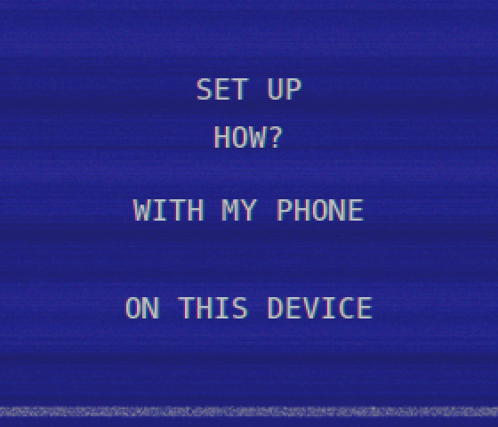
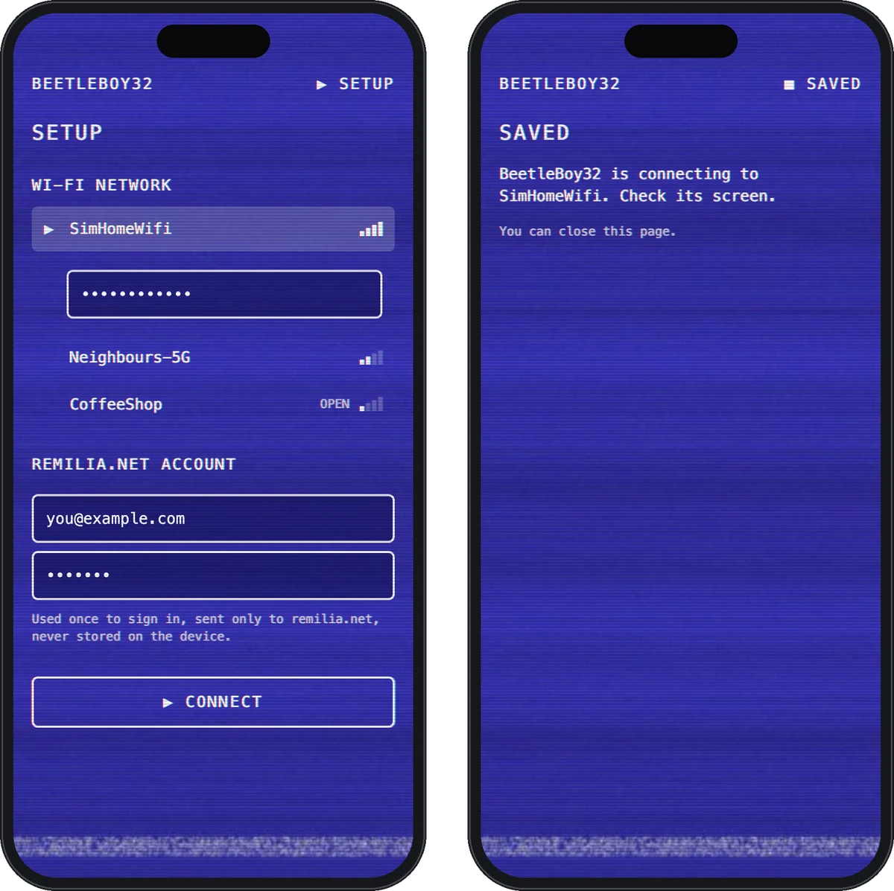

# Setup and login

## First setup

On first boot BeetleBoy32 asks how to set it up.



### With my phone

1. BeetleBoy32 starts its own Wi-Fi network (`BeetleBoy32-XXXX`, random password) and shows a QR code to join it. The name and password are also printed, for laptops.
2. Once a device joins, the screen shows a QR code for the setup page. Phones usually open it by themselves.
3. The page asks for your Wi-Fi network and its password, and your remilia.net email and password. BeetleBoy32 then connects and shows the result.

")



The setup network closes after 10 minutes without a submission, and you're back to the choice.

### On this device

Pick a scanned network, then type its password, your email and your password on the on-screen keyboard. Each key holds a group of characters: tap it again to go to the next one. The bottom-left key switches to capitals, then digits, then symbols.

")

Later, Settings → Wi-Fi adds or forgets networks (up to 8 are remembered), and an expired login asks only for the account again.

## What's stored on the device

| What | Why |
|---|---|
| Wi-Fi networks and passwords | To reconnect |
| The account's session cookies (`AUTH_SESSION_ID`, `KEYCLOAK_SESSION`, `KEYCLOAK_IDENTITY`) | To sign in again without your password |
| A refresh token | To renew the short-lived access token |
| Settings (brightness, volume, timers, time zone, LEDs) | |
| Cached images (avatars, item icons) | Faster screens |

**Your account password is never stored.** It's used once, to sign in.

These are stored as plaintext in the ESP32's flash: anyone with the device and a USB cable could read them.

## How login works

1. **Setup:** your email and password go through remilia.net's normal sign-in page (the same Keycloak login the website uses). BeetleBoy32 keeps the session cookies and tokens it gets back.
2. **Every request:** uses a short-lived access token. Before it expires, the refresh token gets a new one.
3. **If the refresh token is refused:** a silent sign-in with the saved cookies gets fresh tokens, the way the website does when you come back to it.
4. **If that's refused too** (you signed out everywhere, or the session ended): BeetleBoy32 asks for your email and password again. Your Wi-Fi is kept.

Every connection is HTTPS with the server's certificate checked, and the sign-in refuses to follow redirects or forms that leave remilia.net.

## Erasing the device

The device has no reset button. To wipe it (Wi-Fi, the account's cookies and tokens, settings, cached images), erase its flash, then flash it again:

```sh
pio run -e waveshare -t erase
./run flash
```

It then starts with the first setup. In the simulator, hold Esc for 3 seconds and confirm, or delete `sim_data/beetleboy.env`.

To also end the session on the server, use "sign out everywhere" on remilia.net.
