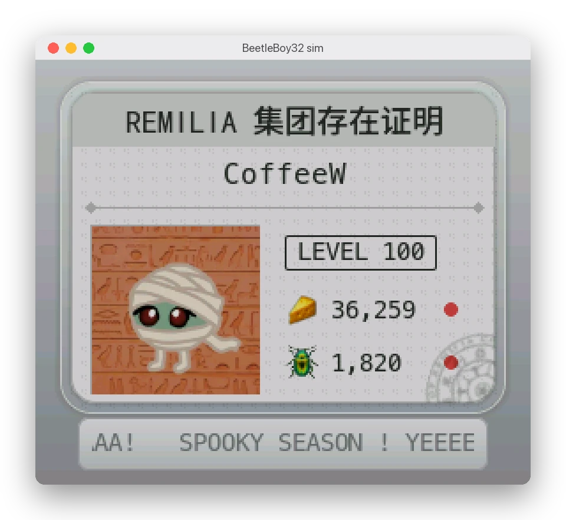
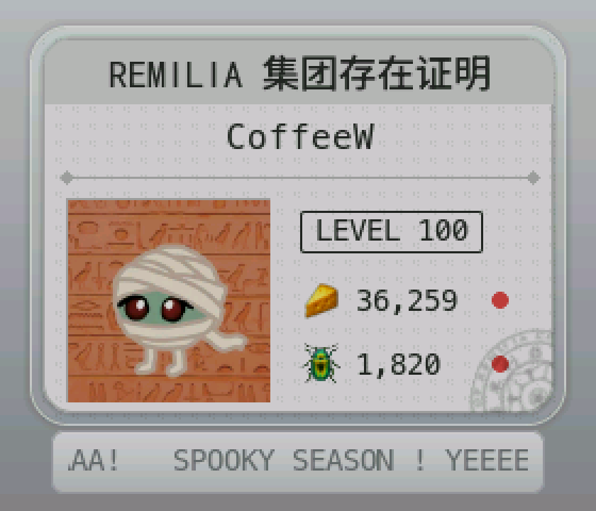
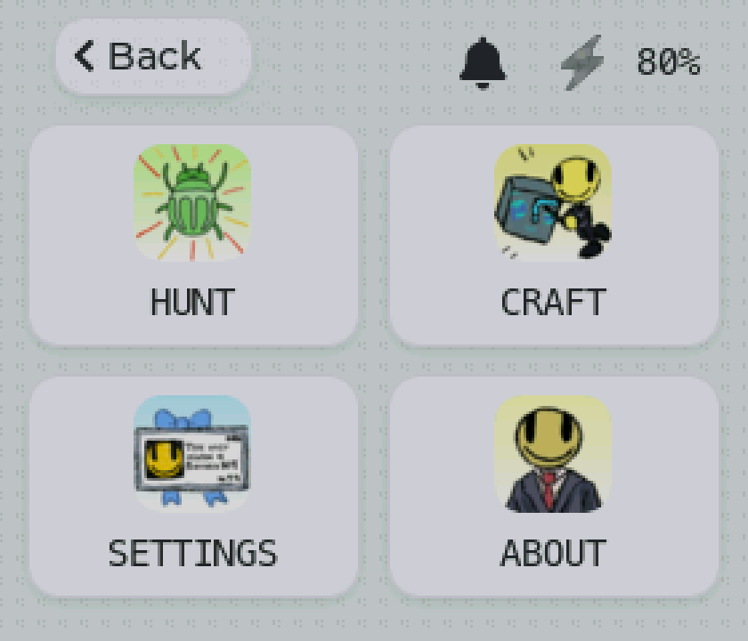
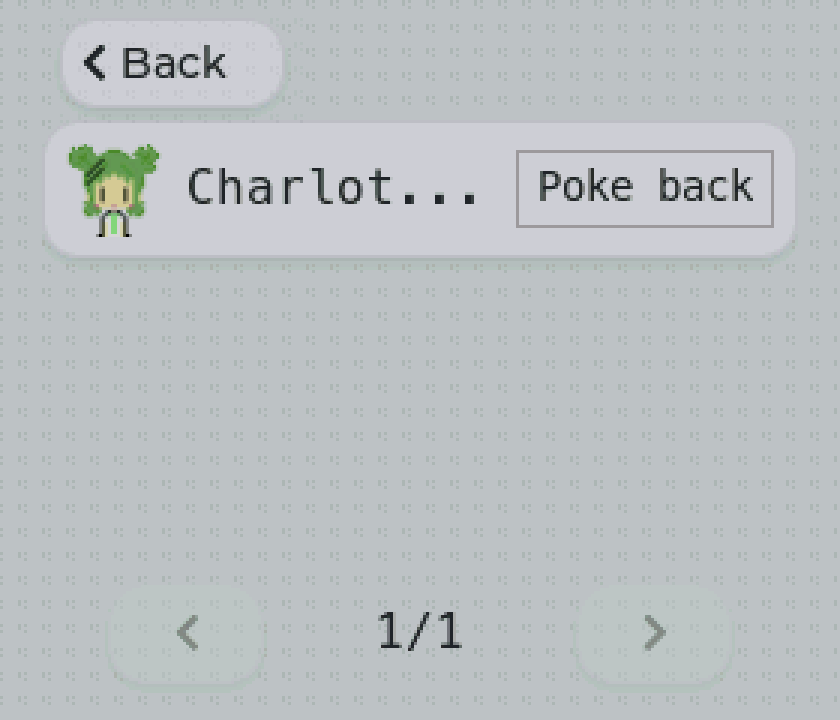
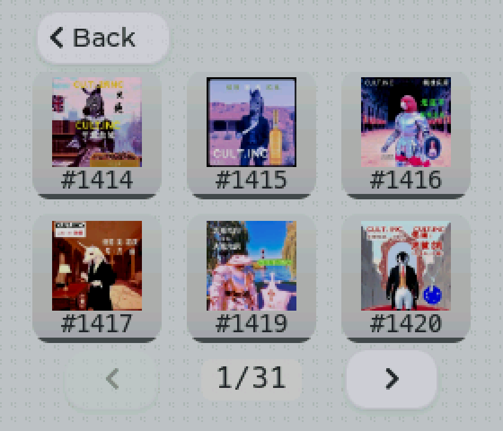
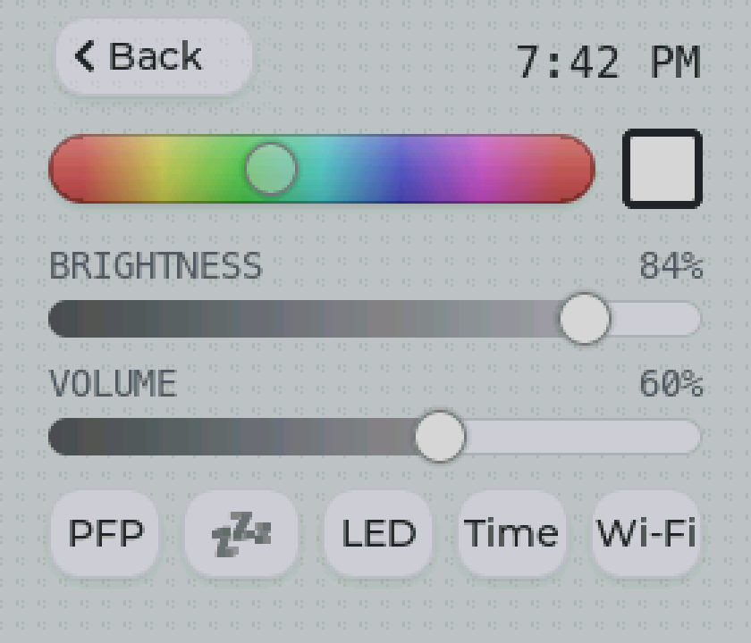
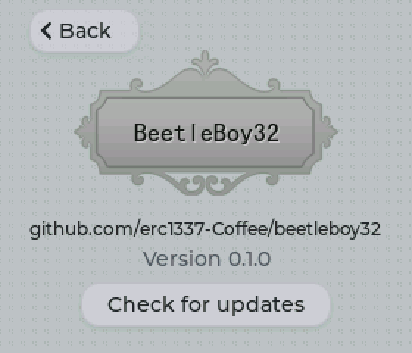

# Simulator

The simulator runs the whole app in a 280×240 window on a Mac: the same screens, setup flow and game logic as the board, against the real remilia.net. Only the hardware is faked (Wi-Fi, the buzzer, the LEDs).



## Requirements

- macOS (it uses CommonCrypto and macOS paths)
- [PlatformIO](https://platformio.org/install/cli)
- SDL2: `brew install sdl2`

## Running

```sh
./run sim
```

It builds what changed, then opens the window.

The device has no buttons: Esc, Enter and Tab stand in for some, for debugging.

| Input | Does |
|---|---|
| Mouse | Touch |
| Esc | Back (hold 3 s: factory reset) |
| Enter / Tab | Press the focused button / focus the next one |
| **J** | A phone joins or leaves the setup network |
| **S** / **W** | Submit setup without the form (good / wrong Wi-Fi password) |
| **D** | Drop or restore the Wi-Fi link |

## Setup in the sim

The setup page is the real one, served at **http://localhost:8080** (this computer only: the form takes your account password). Open it in a browser; opening it counts as "phone joined".

- Wi-Fi is simulated: any password works except `wrong`, which simulates a failed connection.
- The account sign-in is real.

## Saved data

Everything the board keeps in its flash, the sim keeps in `sim_data/beetleboy.env` (plaintext `KEY=value`, ignored by git): Wi-Fi, the account's session cookies and refresh token, settings. Delete the file for a factory-fresh device.

Downloaded images (avatars, item icons) are cached in `sim_data/cache/`.

## Environment variables

| Variable | Does |
|---|---|
| `BB_HOUR=22` | Fakes the hour, e.g. to preview the night background |
| `BB_SCREENSHOT=shot.bmp` | Saves the screen to that file, then exits |
| `BB_SCREENSHOT_MS=1500` | How long to wait before the screenshot |
| `SDL_VIDEODRIVER=offscreen` | No window (with `BB_SCREENSHOT`, for scripts) |

Example: `BB_HOUR=22 ./run sim`.

## Screens







